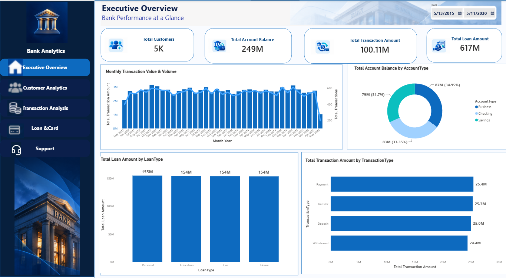
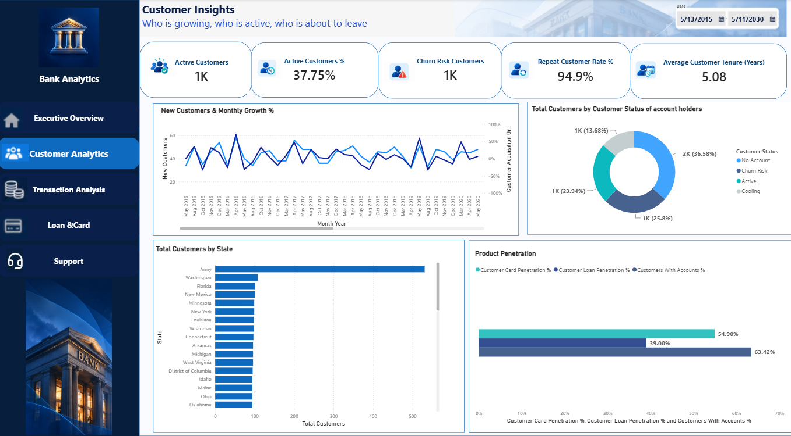
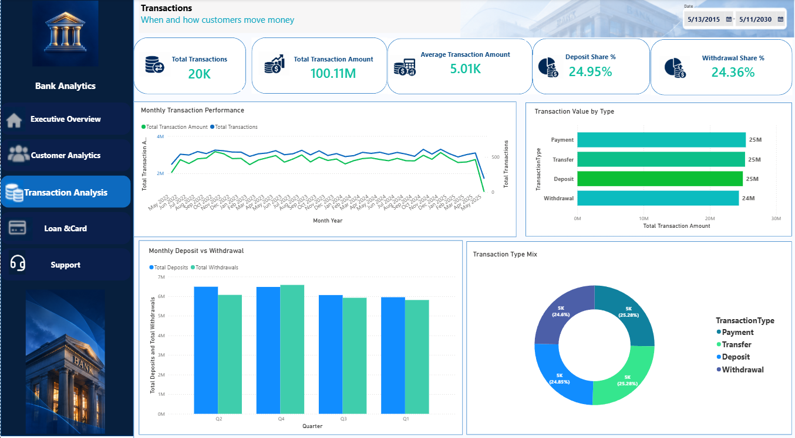
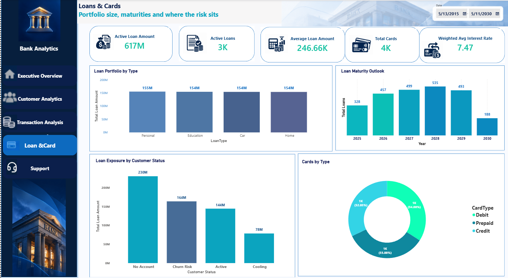
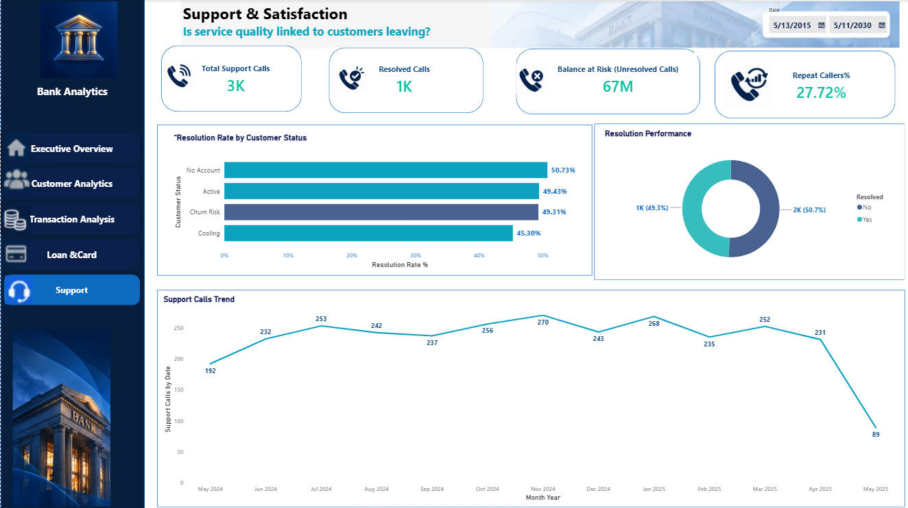

# Banking Analytics: Power BI Dashboard

An end-to-end Power BI project that consolidates banking data (customers, accounts, transactions, loans, cards and support calls) into a 5-page dashboard for customer retention, risk management and operational efficiency.

Built as part of the Instant Data Analysis training.



## Business Questions

1. How big is the bank, and how healthy is it? (customers, balances, transactions, loans)
2. Who are the customers, who is active, and who is at risk of leaving?
3. When and how do customers move money?
4. How large is the loan and card portfolio, and where does the risk sit?
5. Is service quality linked to customers leaving?

## Dataset

Sample banking dataset (Excel), 6 tables:

| Table | Rows | Description |
|---|---|---|
| customers | 5,000 | Customer ID, name, join date, state |
| Accounts | 5,000 | Account type, balance, creation date |
| Transactions | 20,000 | Deposits, withdrawals, transfers, payments |
| Loans | 2,500 | Loan type, amount, interest rate, start and end dates |
| Cards | 4,000 | Card type, issue and expiration dates |
| SupportCalls | 3,000 | Issue type, call date, resolved (Yes/No) |

Full column list and data notes: [`docs/data_dictionary.md`](docs/data_dictionary.md)

## Data Model

Star-style model with `customers` as the central dimension (one-to-many to Accounts, Loans, Cards and SupportCalls) and `Accounts` one-to-many to `Transactions`.

Key modelling decisions:

- **One active date relationship.** `DimDate` is actively related to `Transactions[TransactionDate]` only. Every other date column (JoinDate, CreatedDate, IssuedDate, LoanStartDate, LoanEndDate, CallDate) has an inactive relationship used through `USERELATIONSHIP`. This avoids ambiguous filter paths.
- **Dates are measured from the last date in the data (11 May 2025), not from `TODAY()`**, so Active and Churn Risk definitions stay meaningful on historical data.
- **Customer Status** is a calculated column on `customers`:
  - Active: transaction in the last 90 days of the data
  - Cooling: 90 to 180 days
  - Churn Risk: more than 180 days
  - No Account: customer holds no account
- Rates for customers are calculated on **account holders** (3,171), because 1,829 customers hold no account.

All measures: [`docs/dax_measures.md`](docs/dax_measures.md)

## Dashboard Pages

### 1. Executive Overview
Bank size at a glance: 5K customers, 249M in balances, 100.11M in transactions, 617M in loans, plus monthly transaction value and volume, balance by account type, loans by type and transactions by type.


### 2. Customer Insights
Active and churn-risk customers, repeat customer rate, tenure, customer status mix, product penetration and customers by state.



### 3. Transaction Analysis
Transaction volume and value over time, deposits vs withdrawals by quarter, and the mix by transaction type.



### 4. Loans & Cards
Loan portfolio by type, maturity outlook by year, loan exposure by customer status, weighted average interest rate and card mix.



### 5. Support & Satisfaction
Call volume, resolution rate by customer status, repeat callers and the balance held by customers with unresolved calls.



A PDF version of the dashboard is in [`report/banking_analysis_dashboard.pdf`](report/banking_analysis_dashboard.pdf).

## Key Insights

**Customers**

- Only **63%** of customers (3,171 of 5,000) hold an account; **36.6%** (1,829) hold none.
- Only **23.9%** of all customers (37.8% of account holders) made a transaction in the last 90 days.
- **25.8%** of customers (about 1,290) are Churn Risk: no transaction for more than 180 days.
- Product penetration: accounts 63.4%, cards 54.9%, loans 39.0%.

**Transactions**

- Transaction value is spread almost evenly across the four types (about 25M each), and deposits (24.95%) are very close to withdrawals (24.36%).
- Monthly volume is stable, with no strong trend or seasonality in this sample.

**Loans and cards**

- The loan book is **617M** across 2,500 loans (average 246.66K, weighted average interest rate 7.47%), split almost evenly over Home, Car, Personal and Education (about 154M each).
- **164M (27%)** of loan value is held by Churn Risk customers, and **230M (37%)** by customers with no account.
- Loan maturities peak in **2028 (535 loans)**.
- All 4,000 cards expire between May 2026 and May 2030, with **584 expiring in 2026** and 1,044 in 2027, which is the renewal pipeline.

**Support**

- Only **49.3%** of the 3,000 calls are resolved, and **27.7%** of callers phoned more than once.
- Resolution rate is almost the same for Churn Risk (49.3%) and Active (49.4%) customers, so **service quality does not explain churn in this dataset**. The problem is general across all customer groups and issue types.
- **1,303 customers** have unresolved calls, and they hold **67M (about 27%)** of total account balances.

## Recommendations

1. **Re-engage Churn Risk customers**, starting with those holding loans (164M exposure) and unresolved calls.
2. **Cross-sell accounts** to customers who hold only a loan or card; 37% of loan value sits with customers who have no account.
3. **Raise the resolution rate** (currently about 49%) and prioritise the 1,303 customers with unresolved calls and high balances.
4. **Plan card renewals** for 2026 and 2027, when more than 1,600 cards expire.
5. **Prepare for the 2027 to 2029 loan maturity peak** with refinancing offers.

## Data Notes and Limitations

- The dataset is a **sample**; distributions are unusually even, so patterns may differ on production data.
- All loans are active at the last data date, so Active Loan Amount equals Total Loan Amount. No card is expired at that date.
- Support calls start on 11 May 2024 and the data ends on 11 May 2025, so the first and last months in monthly charts are partial.
- The state "Army" has about 530 customers versus about 100 for other states; it was not investigated further.
- Totals were checked against the source Excel file (loans 616,658,893; balances 249,370,795; 3,000 support calls).

## Tools

Power BI Desktop, DAX, Power Query, Excel.

## Repository Structure

```
├── banking_analysis.pbix
├── screenshots/
├── report/
│   └── banking_analysis_dashboard.pdf
└── docs/
    ├── data_dictionary.md
    └── dax_measures.md
```

## How to Use

Open `banking_analysis.pbix` in Power BI Desktop. The data is loaded into the model, so no external source is needed.

## Author

Mohamed, Data Analyst. [GitHub](https://github.com/mohamedelshehawy-DATA)
